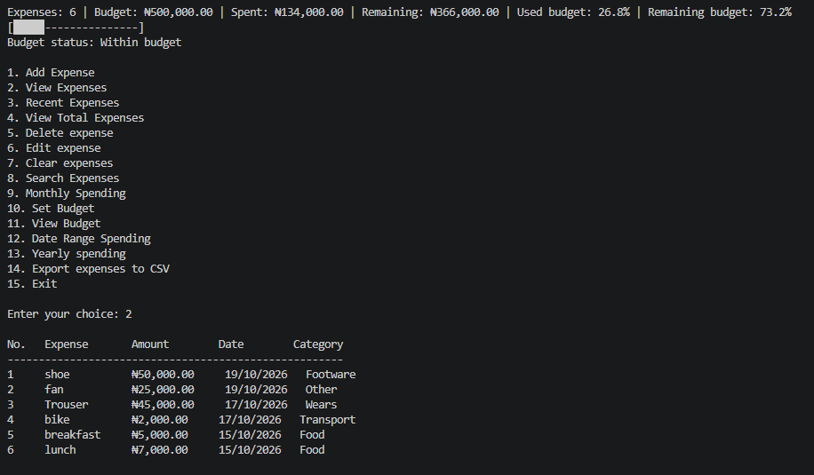

# Personal Expense Tracker

A command-line expense tracker built with Python to help manage daily spending, organize expenses by category, and understand monthly spending patterns.

## Screenshot



## Features

- Add, view, edit, and delete expenses.
- Record expense descriptions, amounts, dates, and categories.
- Calculate total spending.
- Group expenses by category.
- View monthly spending summaries.
- Identify the month with the highest spending.
- Set and track a spending budget.
- Export expense records to CSV.
- Store expense data locally in JSON format.
- Format monetary values in Nigerian naira (₦).

## Requirements

- Python 3.10 or later recommended.
- No external packages required if the application uses only Python's standard library.

## Getting Started

### 1. Clone the repository

```bash
git clone https://github.com/cfez/expense-tracker.git
cd expense-tracker
```

### 2. Run the application

```bash
python expense_tracker.py
```

On some Windows installations, you may need to use:

```bash
py expense_tracker.py
```

Follow the prompts in the terminal to manage your expenses.

## Data and Privacy

Expense records are stored locally in `expenses.json`. This file is excluded from version control to help prevent personal spending information from being uploaded to GitHub.

The application may also create local budget settings and CSV exports. These personal files should remain excluded from version control.

Keep backups of your personal expense data in a safe location.

## Technologies

- Python
- JSON
- CSV
- Git and GitHub

## Future Improvements

- Add automated tests.
- Improve error handling and input validation.
- Add spending visualizations.

## Author

Developed as a Python portfolio project.
